# ⚡ NetPacket-Sentinel-AI — Tactical Cyber SOC Deck & Autonomous Deep Packet Forensics Platform

<div align="center">

[](https://www.python.org/)
[](https://pywebview.flowrl.com/)
[](https://scapy.net/)
[](https://scikit-learn.org/)
[](https://www.virustotal.com/)
[](https://attack.mitre.org/)
[-success.svg?style=for-the-badge)](https://www.unb.ca/cic/datasets/ids-2017.html)
[](LICENSE)

<p align="center">
  <strong>منظومة أمنية تكتيكية متكاملة لغرف العمليات الأمنية (SOC) والتحقيق الجنائي الرقمي للشبكات (DFIR)<br>مدعومة بمحرك ذكاء اصطناعي هجين، استدلال جنائي آلي للأسئلة الأربعة (4Q Forensic Grounding)، وتوليد فوري لقواعد الحظر التكتيكية.</strong>
</p>

</div>

---

## 🎯 قمرة القيادة التكتيكية (Primary Tactical SOC Deck Overview)

<div align="center">
  
  <p><em>الشكل 1: قمرة القيادة التكتيكية لنظام NetPacket-Sentinel-AI — حالة التأهب DEFCON 1، فاحص الحزم الثلاثي بمستوى Wireshark، ومؤشرات التحليل الجنائي والذكاء الاصطناعي اللحظية.</em></p>
</div>

---

## 📖 1. ما هو NetPacket-Sentinel-AI؟ (System Overview)

**NetPacket-Sentinel-AI** هو نظام متكامل للأمن السيبراني والتحقيق الجنائي الرقمي (**Digital Forensics & Incident Response - DFIR**) يعمل كتطبيق سطح مكتب تكتيكي عالي الكفاءة.

صُمم النظام ليعمل كـ **قمرة قيادة لغرف العمليات الأمنية (Tactical SOC Deck)**؛ حيث يقوم بفك وتفكيك حركة مرور الشبكة المعقدة (**PCAP / PCAPNG**) بدقة الميكروثانية، ويدمج هذا التحليل مباشرة مع **محرك ذكاء اصطناعي هجين (Hybrid ML Engine)** لكشف الشذوذ وهجمات اليوم الصفر (**Zero-Day Attacks**)، وربط التهديدات بمعيار **MITRE ATT&CK Enterprise v16** عالمياً، مع الإجابة الآلية الذكية عن **الأسئلة الجنائية الأربعة (Forensic 4Q Grounding)** وتوليد أوامر وقواعد الحظر الفوري بنقرة زر واحدة.

يعتمد النظام على واجهة زجاجية حديثة (**Cyber Glassmorphism Theme**) مبنية بتقنيات الويب الأصلية وفائقة السرعة، وتعمل عبر نافذة سطح مكتب مستقلة عبر محرك `pywebview` دون استهلاك موارد الذاكرة أو الحاجة لمتصفح خارجي.

---

## 🏗️ 2. الهيكل المعماري للنظام (System Architecture)

يعمل المشروع وفق بنية متكاملة متعددة الطبقات تربط فحص الحزم الخام بالاستدلال الذكي والاستجابة الآلية دون انقطاع:

```
┌─────────────────────────────────────────────────────────────────────────────┐
│                           1. مدخلات حركة المرور الخام                        │
│                ملفات التقاط الشبكة بدقة الميكروثانية (PCAP / PCAPNG)        │
└──────────────────────────────────────┬──────────────────────────────────────┘
                                       │
                                       ▼
┌─────────────────────────────────────────────────────────────────────────────┐
│                 2. محرك التفكيك الجنائي المتقدم (Deep Forensic Core)         │
│  • تشريح كامل لطبقات الشبكة L2-L7 (Ethernet, 802.1Q VLAN, IPv4/IPv6, TCP/UDP) │
│  • تتبع وإعادة بناء جلسات TCP و HTTP ثنائية الاتجاه (Stream Follower)       │
│  • نحت واستخراج الملفات المضمنة من الحمولات (File Carver Engine)             │
│  • قياس إنتروبيا شانون وفك تشفير الحمولات المشوشة (Base64/Hex/URL/Gzip/XOR)   │
└──────────────────────────────────────┬──────────────────────────────────────┘
                                       │
                                       ▼ (مصفوفة الميزات الإحصائية 69-NetFlow Features)
┌─────────────────────────────────────────────────────────────────────────────┐
│                   3. محرك الذكاء الاصطناعي الهجين (AI Sentinel Engine)      │
│  • مصنف Random Forest متعدد الفئات (دقة 99.90% مدرب على 446k عينة CICIDS2017) │
│  • كاشف الشذوذ غير المراقب Isolation Forest (Zero-Day Outlier Contamination) │
│  • قاعدة السلوك الزمني المتجهية (IP Rate Velocity: 20 conns / 2s Window)     │
│  • محكم القرارات الهجين (Hybrid Decision Arbiter: منع الإيجابيات الكاذبة)    │
│  • رادار إنتروبيا الـ DNS لكشف قنوات DGA و C2 Beaconing الدورية              │
└──────────────────────────────────────┬──────────────────────────────────────┘
                                       │
                                       ▼ (بيانات JSON مهيكلة ومؤمنة عبر الجسر المحلي)
┌─────────────────────────────────────────────────────────────────────────────┐
│                 4. جسر التخاطب التكتيكي (CyberBridgeAPI Controller)          │
│  توصيل التحليلات الجنائية، استخبارات VirusTotal، وأوامر العزل إلى واجهة العرض │
└──────────────────────────────────────┬──────────────────────────────────────┘
                                       │
                                       ▼
┌─────────────────────────────────────────────────────────────────────────────┐
│                 5. قمرة القيادة التكتيكية (Tactical SOC Deck GUI)            │
│  • فاحص الحزم الثلاثي بمستوى Wireshark (Dissector + Hex Dump + Entropy)      │
│  • قمرة الأسئلة الجنائية 4Q وبطاقات السرد القصصي للحادثة التكتيكية           │
│  • توبولوجيا الهجوم الحية (D3.js Force Cluster & Golden Tree Hierarchy)      │
│  • مصفوفة MITRE ATT&CK المتوهجة وعداد السرعة لسمعة التهديد (VirusTotal CTI)   │
│  • رادار DNS & TLS SNI ومحاكي الذكاء الاصطناعي التفاعلي (AI Sandbox)         │
│  • قوالب الاستجابة الآلية لتوليد قواعد الحظر الفوري (iptables/PowerShell)    │
└─────────────────────────────────────────────────────────────────────────────┘
```

---

## 🚀 3. الميزات والقدرات الجوهرية (Core Capabilities)

### أ. التحليل الجنائي العميق للحزم (Deep Packet Forensics & Dissection)
* **تغطية شاملة لبروتوكولات الشبكة (L2–L7):** فك تشريح دقيق للحزم يشمل بروتوكولات `Ethernet II`, `802.1Q VLAN`, `ARP`, `IPv4`, `IPv6`, `ICMP`, `UDP`, و `TCP` مع استخراج كامل للأعلام التسعة (`SYN`, `ACK`, `FIN`, `RST`, `PSH`, `URG`, `CWR`, `ECE`).
* **فاحص الحزم الثلاثي (Wireshark-Grade 3-Pane Dissector):** لوحة تكتيكية ثلاثية تتضمن:
  1. **Packet Frame List:** عرض رقم الحزمة، التوقيت، المصدر، الوجهة، البروتوكول، الحجم، ومعلومات الراية.
  2. **Protocol Tree:** شجرة قابلة للطي والفتح تظهر تفاصيل الترويسات لكل طبقة.
  3. **Hex Dump & Byte Entropy:** عارض سداسي عشري خام مع مؤشر إنتروبيا البايتات لكشف الحمولات المشفرة أو المضغوطة.
* **إعادة تجميع المحادثات (Stream Reassembly):** تتبع محادثات جلسات TCP و HTTP ثنائية الاتجاه مع تلوين واضح لحركة العميل (Client) باللون السماوي وحركة الخادم (Server) باللون الأخضر/البرتقالي.
* **نحت الملفات المستخرجة (File Carving Engine):** استخراج تلقائي وفوري للملفات المضمنة في حركة المرور (ملفات تنفيذية `EXE/ELF`، مستندات `PDF`، أرشيفات `ZIP`، وغيرها) مع احتساب بصمات التجزئة التشفيرية (`SHA-256` و `MD5`).
* **فك تشفير الحمولات المشوشة (Payload Decoder):** محلل متعدد الصيغ لفك تعمية الحمولات المشبوهة (`Base64`, `Hex`, `URL Encoding`, `Gzip Decompression`, و `XOR Reverse-Engineering`).

---

### ب. محرك الذكاء الاصطناعي الهجين (Hybrid AI Threat Detection)
* **المصنف المراقب متعدد الفئات (Supervised Random Forest):**
  * مُدرب ومُقيّم على أكثر من **446,000 عينة تدفق** من بيانات معيار **CICIDS2017** الدولية.
  * يحقق نسبة دقة موثقة تبلغ **99.90%** ونسبة توازن **F1-Score تبلغ 99.65%**.
  * تصنيف فوري لأكثر من **15 نوعاً من التهديدات** (DDoS, PortScan, Botnet, Infiltration, Web Attacks, SSH/FTP Patator, DoS Hulk/Slowloris, وغيرها).
* **كاشف هجمات اليوم الصفر غير المراقب (Zero-Day via Isolation Forest):**
  * مُدرب بشكل منفصل على حركة المرور الطبيعية المعيارية (**1.51 مليون سجل benign**).
  * قادر على اكتشاف أي شذوذ هيكلي أو إحصائي جديد لم يسبق تسجيله دون الاعتماد على توقيعات مسبقة.
* **محكم القرارات الهجين (Hybrid Decision Arbiter):**
  * يدمج تنبؤات النموذج المراقب (Supervised Confidence) مع درجة شذوذ النموذج غير المراقب (Anomaly Score)، مع فحص التوقيعات وقاعدة السلوك الزمني (`IP Rate Rule: 20 conn / 2s`).
  * يضمن الوصول إلى معدل **Zero False Negatives** في الحالات الحرجة.
* **استخراج 69 ميزة إحصائية متطورة (69-Feature NetFlow Pipeline):**
  * استخراج فوري لميزات التدفق: متوسط وأوزان أحجام الحزم، فترات الوصول البيني (IAT)، تقلبات النوافذ الزمنية، ونسب أعلام الـ TCP.

---

### ج. الاستدلال الجنائي الذكي للأسئلة الأربعة (Forensic 4Q Grounding)
يقوم النظام آلياً بتحويل ملايين سجلات الشبكة إلى سرد تحليلي جنائي موحد يُجيب بدقة عن الأسئلة المحورية لأي محقق رقمي:
1. **ماذا حدث؟ (What Happened):** تصنيف دقيق لطبيعة الهجوم مع ربط مباشر برقم تقنية وتكتيك **MITRE ATT&CK**.
2. **من الفاعل ومن المستهدف؟ (Who & Targets):** تحديد عنوان الـ IP المهاجم (داخلي أو خارجي)، دولة المصدر، ومزود الخدمة (ASN)، مع حصر الأنظمة والخدمات المستهدفة بدقة.
3. **متى بدأ وكيف تطور؟ (When & Evolution):** تتبع زمني بالميكروثانية لخطوات الهجوم ومطابقتها مع مراحل سلسلة القتل السيبراني (**Cyber Kill Chain**).
4. **هل الهجوم مستمر؟ (Ongoing Status):** قياس استمرارية النشاط، كشف دورية اتصالات التحكم والسيطرة (**C2 Beaconing Detection** مع معامل تشتت $CV < 0.2$)، وتحديد أولوية العزل فوراً.

---

### د. استخبارات التهديدات والرادار التكتيكي (Threat Intelligence & CTI)
* **تكامل VirusTotal v3 API:** استعلام فوري عن سمعة عناوين الـ IP والمجالات المشبوهة مع عرض مقياس سرعة نصفي دائري متوهج (Gauge) لتقييم الخطورة.
* **مصفوفة MITRE ATT&CK v16:** إبراز توهج التكتيكات والتقنيات المستخدمة في الهجوم المسجل داخل المصفوفة التكتيكية العالمية.
* **رادار إنتروبيا الـ DNS:** حساب إنتروبيا شانون ($H(x) = -\sum P(x) \log_2 P(x)$) لأسماء النطاقات المستعلم عنها لكشف خوارزميات توليد النطاقات (**DGA**) وقنوات تسريب البيانات المشفرة (**DNS Tunneling**) عند تجاوز العتبة ($H > 4.1$).
* **استخراج ترويسات TLS SNI دون فك التشفير:** تحليل مصافحة `ClientHello` واستخراج النطاقات المستهدفة وإصدارات التشفير (`TLS 1.2` / `TLS 1.3`) لتتبع قنوات الـ C2 المستترة في الاتصالات الآمنة.

---

### هـ. الاستجابة الآلية وعزل الحوادث (Autonomous Containment Playbooks)
بمجرد تأكيد التهديد، يوفر النظام أوامر حظر فورية جاهزة للتنفيذ بنقرة واحدة لحماية الأنظمة المهددة:
* أوامر جدار الحماية لنظام لينكس (**iptables** و **nftables**).
* أوامر جدار حماية ويندوز المتقدم (**New-NetFirewallRule** عبر PowerShell).
* قواعد التحكم في الوصول لأجهزة الشبكة (**Cisco IOS ACLs**).
* إمكانية تصدير سكريبت عزل تنفيذي مباشر بصيغة `.sh` أو `.ps1`.

---

### و. محاكي الذكاء الاصطناعي ودليل المناقشة (AI Sandbox & Viva Defense)
* **المحاكي التفاعلي (Interactive AI Sandbox):** بيئة تجريبية تسمح للمحلل بالتعديل اليدوي على خصائص التدفق (عدد الحزم، مدة الاتصال، حجم البايتات، والتردد) ومشاهدة استجابة الذكاء الاصطناعي وتغير احتمالات التصنيف لحظياً.
* **معيار النماذج ودليل الدفاع الأكاديمي (Benchmark & Viva Masterclass):** عرض مصفوفة الارتباك (Confusion Matrix)، منحنيات ROC-AUC، والإجابات النموذجية على أسئلة لجان التحكيم ومناقشة مشاريع التخرج في الأمن السيبراني.

---

## 📸 4. معرض قمرة القيادة والواجهات التكتيكية (Verified Screenshot Gallery)

تم تنظيم المعرض بشكل احترافي ومنهجي يضم **29 لقطة شاشة فريدة بنسبة 100% دون أي تكرار**، ومقسمة وفق الأجنحة التشغيلية لقمرة القيادة:

### أولاً: قمرة القيادة التكتيكية والواجهة الشاملة (Tactical SOC Deck & Panoramas)

| 01. قمرة القيادة التكتيكية الرئيسية (Hero SOC Deck) | 27. البانوراما الزجاجية للوضع الداكن (Dark Glassmorphism) |
|:---:|:---:|
|  | 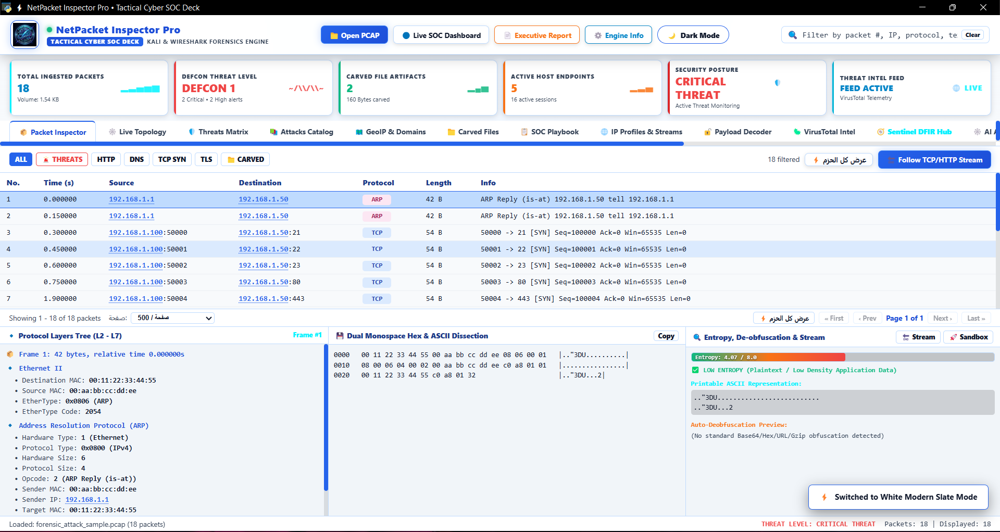 |
| *الشكل 1: قمرة القيادة المتكاملة مع مؤشرات DEFCON 1 ورادار حركة المرور الحية* | *الشكل 2: الواجهة التكتيكية الزجاجية بالوضع الليلي الكامل* |

| 22. بيئة سطح المكتب الأصلية (pywebview Runtime) | 26. شريط التصفية التكتيكي (Malicious Scope Filter) |
|:---:|:---:|
| 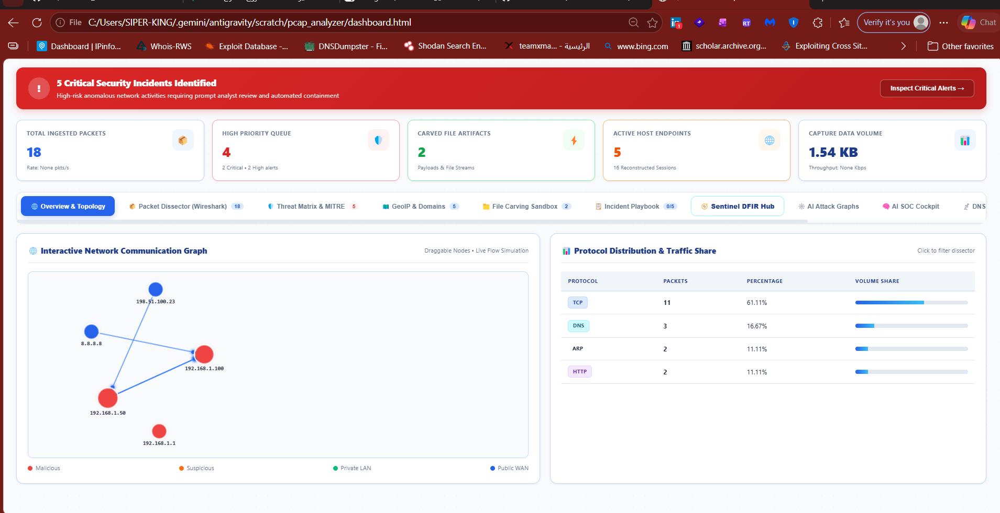 | 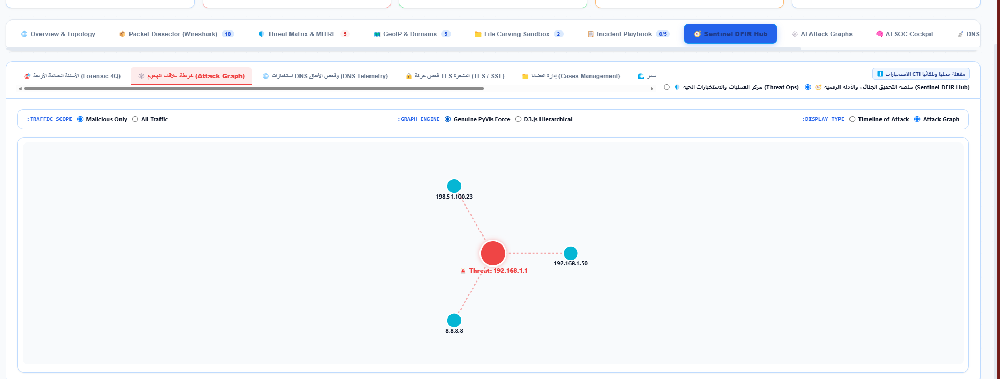 |
| *الشكل 3: التطبيق يعمل كنافذة سطح مكتب مدمجة وسريعة دون استهلاك الذاكرة* | *الشكل 4: عزل وتصفية حركة المرور الخبيثة بنقرة واحدة* |

---

### ثانياً: فاحص الحزم وتفكيك البروتوكولات (Deep Packet Dissection & Streams)

| 02. فاحص الحزم الثلاثي (Wireshark 3-Pane Dissector) | 28. إعادة تجميع جلسات TCP ثنائية الاتجاه (Stream Follower) |
|:---:|:---:|
| 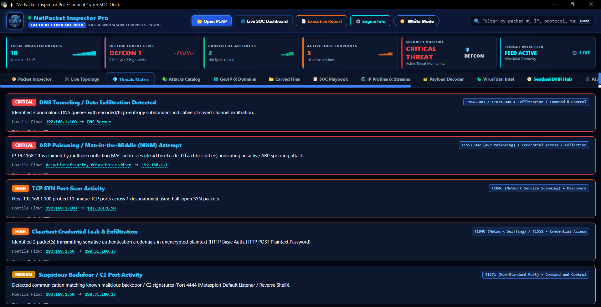 | 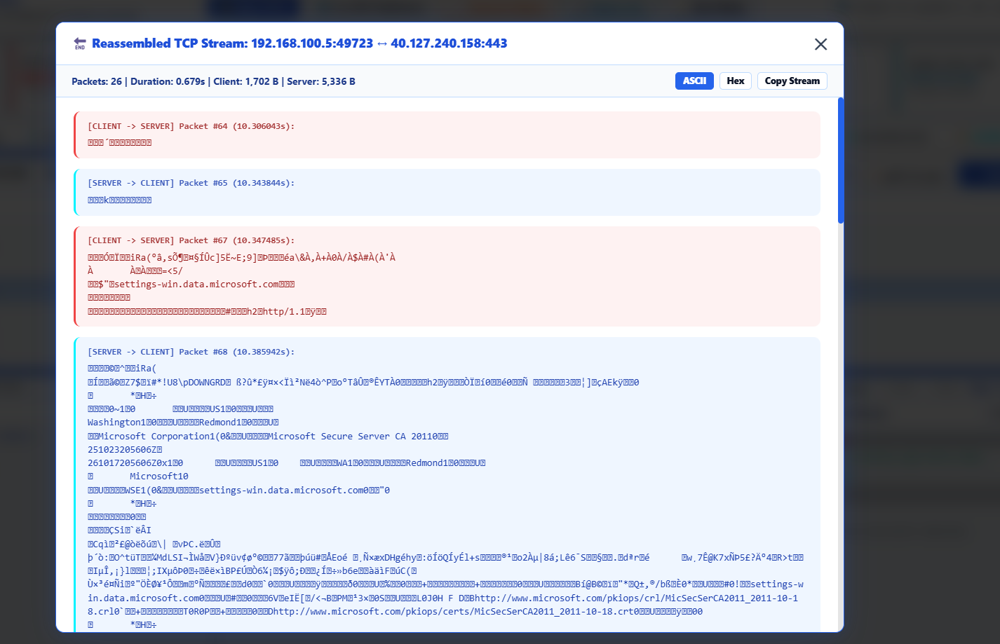 |
| *الشكل 5: قائمة الحزم، شجرة البروتوكولات، و Hex Dump مع إنتروبيا البايتات* | *الشكل 6: تتبع محادثة الجلسة بتلوين تفاعلي لحركة العميل والخادم* |

| 25. فحص الحمولات الخام (Raw Payload Inspection) | 05. فك تشفير الحمولات المشوشة (Payload Decoder) |
|:---:|:---:|
| 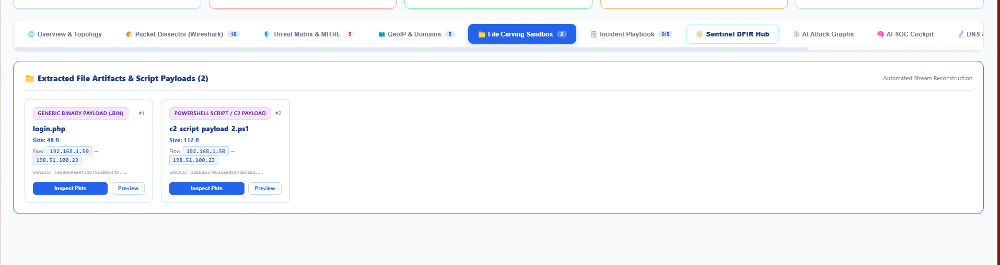 | 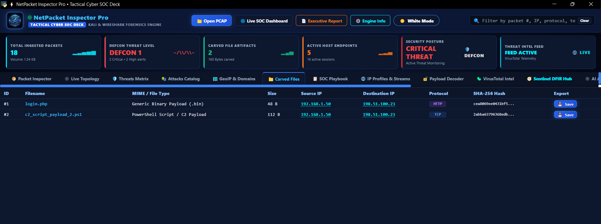 |
| *الشكل 7: كشف حمولات الويب الخام واستخراج طلبات login.php المشبوهة* | *الشكل 8: فك تعمية النصوص المشفرة بالـ Base64 و Hex و Gzip و XOR* |

---

### ثالثاً: نحت الملفات والأدلة الجنائية (File Carving & DFIR Hub)

| 07. نحت الملفات المضمنة (File Carving Engine) | 21. منصة وخزنة الأدلة الجنائية (DFIR Evidence Hub) |
|:---:|:---:|
| 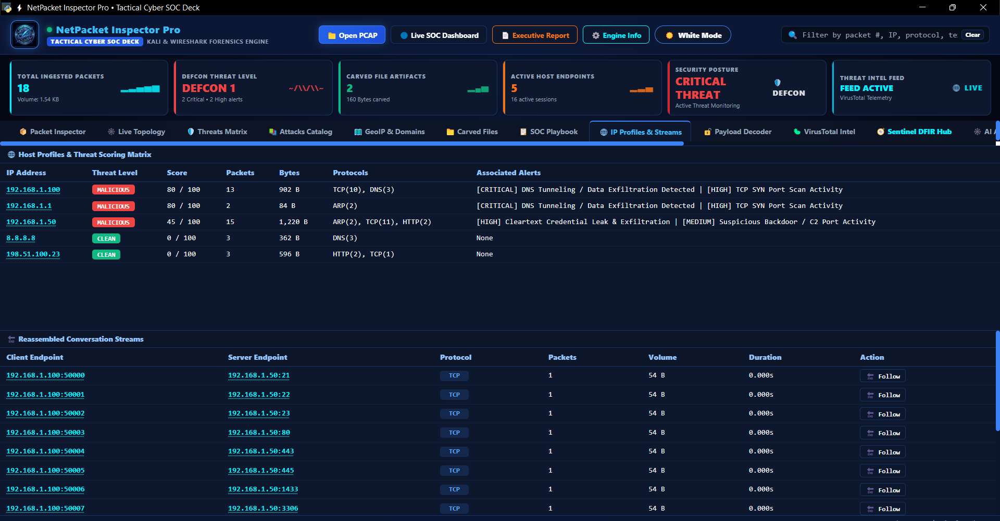 |  |
| *الشكل 9: استخراج الملفات المضمنة عبر المنافذ وتوليد بصمات التجزئة التشفيرية* | *الشكل 10: إدارة الأدلة الجنائية وتصدير الملفات المحفوظة على القرص* |

| 12. الخط الزمني للحوادث (DFIR Case Timeline) | 10. درج قابلية تفسير التدفقات (Explainability Drawer) |
|:---:|:---:|
| 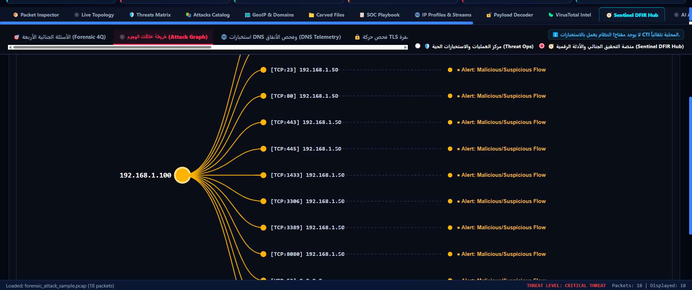 | 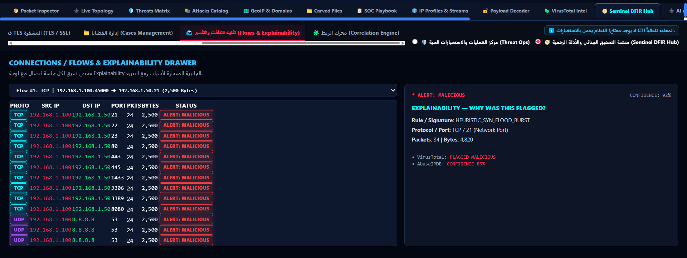 |
| *الشكل 11: التتبع الزمني المتسلسل للأحداث الأمنية المترابطة* | *الشكل 12: تفصيل الأوزان الإحصائية وعوامل اتخاذ القرار للذكاء الاصطناعي* |

---

### رابعاً: استخبارات التهديدات ومصفوفة مايتر (Threat Intel & MITRE ATT&CK)

| 03. مصفوفة MITRE ATT&CK v16 وسمعة VirusTotal | 23. طابور فرز التهديدات الحرجة (High-Priority Queue) |
|:---:|:---:|
| 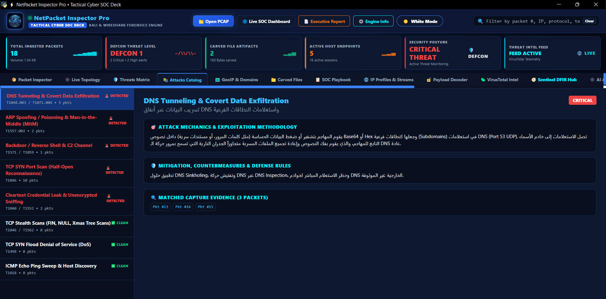 | 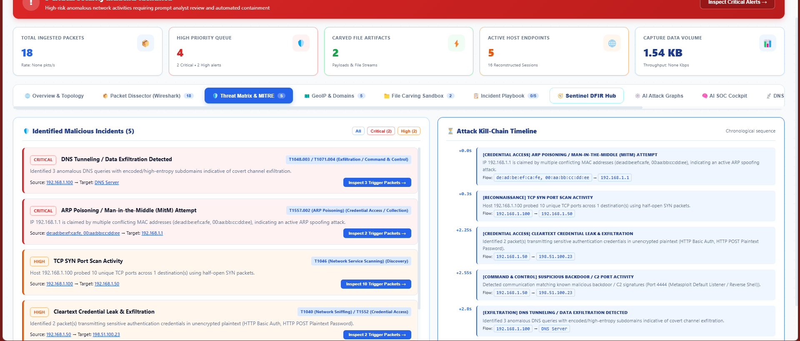 |
| *الشكل 13: تظليل تقنيات الهجوم المتوهجة وعداد السرعة لسمعة الـ IP* | *الشكل 14: قائمة فرز الحوادث الأمنية الأكثر خطورة للمحللين* |

| 24. شريط التنبيهات الأمنية الحية (Live Alerts Banner) | 11. موسوعة هجمات الشبكة (Network Attacks Catalog) |
|:---:|:---:|
| 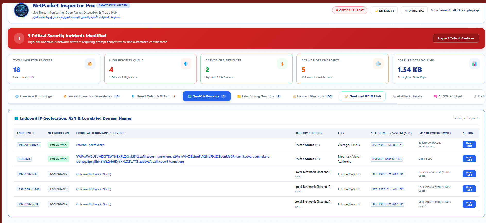 | 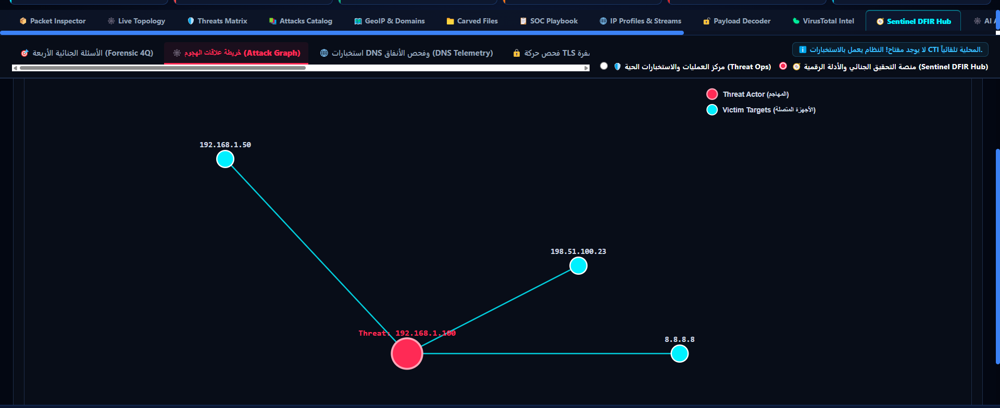 |
| *الشكل 15: مراقبة فورية للحوادث الأمنية المصنفة كحرجة (Critical)* | *الشكل 16: فهرس وتوقيعات هجمات كالي لينكس وأنظمة NIDS* |

---

### خامساً: التموضع الجغرافي والتحقيق في الكيانات (GeoIP & Entity Investigation)

| 06. خريطة التهديدات الجغرافية العالمية (GeoIP & ASN Map) | 29. التحقيق العميق في هوية الكيان (IP Entity Dossier) |
|:---:|:---:|
| 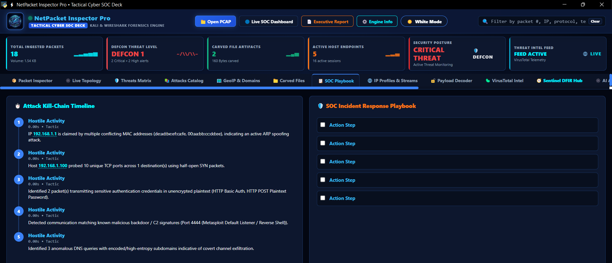 | 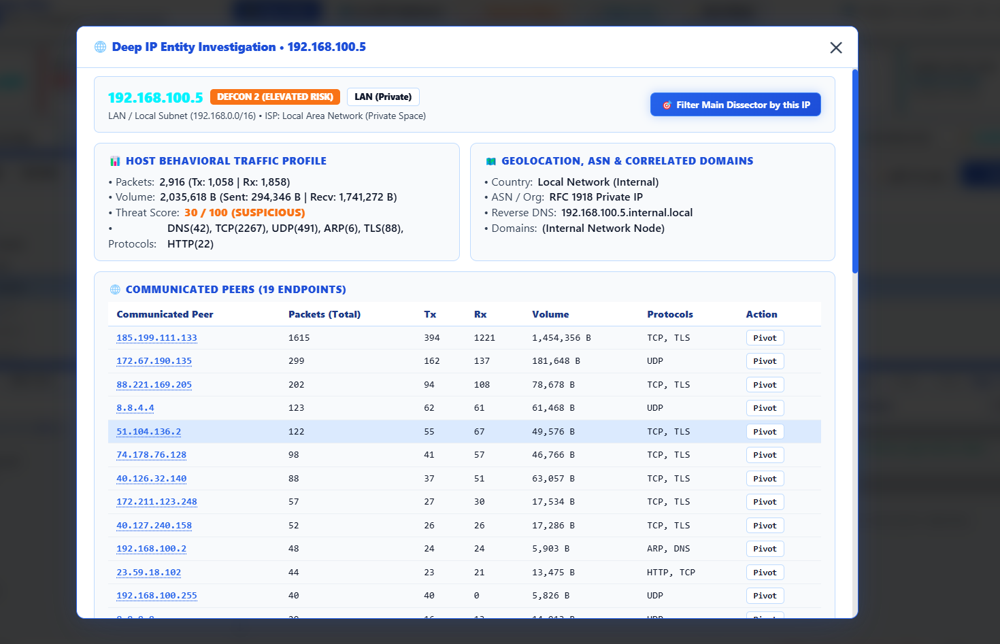 |
| *الشكل 17: الخريطة الجغرافية العالمية لمصادر الهجمات وتوزيع الأنظمة المستقلة* | *الشكل 18: ملف أمني متكامل للـ IP مع مؤشر DEFCON 2 وسلوك التدفقات* |

| 04. فحص البنية التحتية للنطاقات (Domain Infra Inspection) | 09. استخراج ترويسات اتصالات TLS SNI المشفرة |
|:---:|:---:|
| 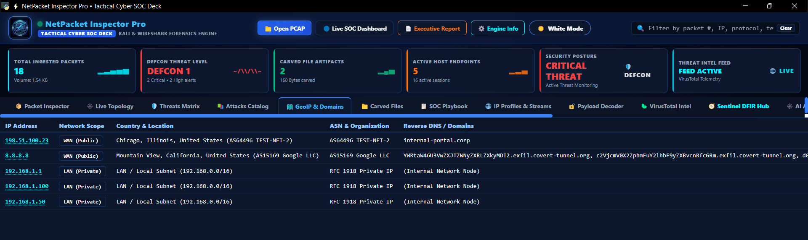 | 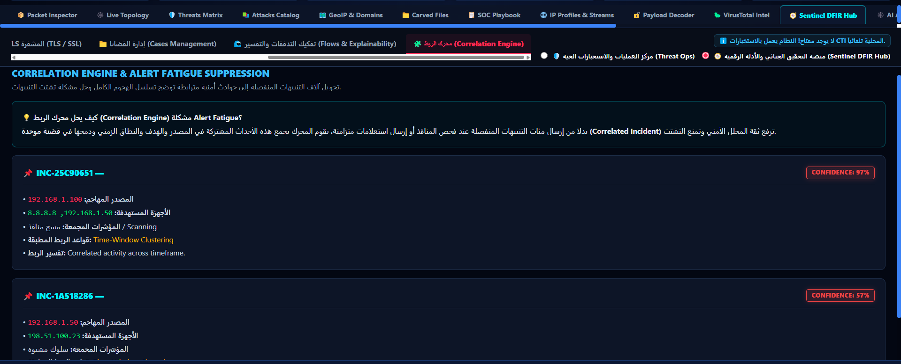 |
| *الشكل 19: فحص وتحديد مزودي الخدمات السحابية ونطاقات DNS الخارجية* | *الشكل 20: استخراج نطاقات ClientHello وإصدارات التشفير دون فك التشفير* |

---

### سادساً: محرك الاستدلال الجنائي 4Q وتوبولوجيا الهجوم (AI 4Q & Attack Topology)

| 16. قمرة الذكاء الاصطناعي 4Q (AI 4Q Grounding Cockpit) | 13. بطاقات سيناريو الحادثة التكتيكية (Incident Story Cards) |
|:---:|:---:|
| 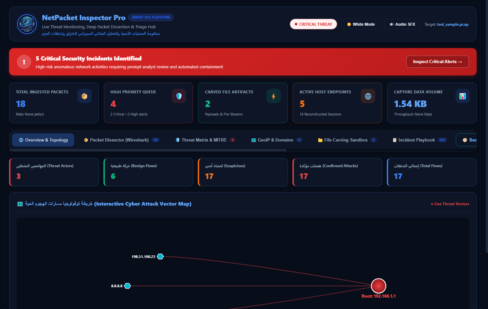 | 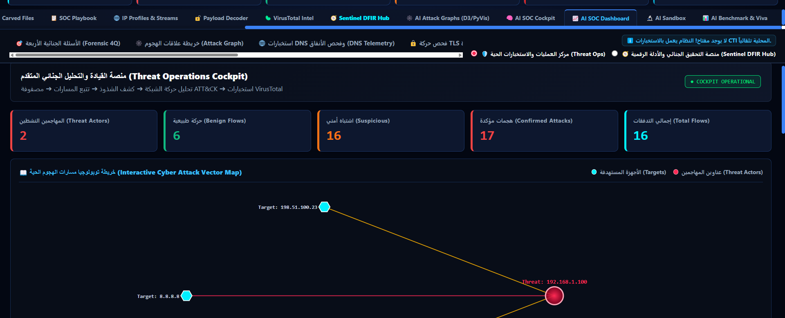 |
| *الشكل 21: الإجابة الآلية عن الأسئلة الأربعة (What, Who, When, Ongoing)* | *الشكل 22: بطاقات النيون المتفاعلة لسرد تفاصيل مسار الهجوم وسلوكه* |

| 14. تطور مراحل الهجوم (Cyber Kill Chain Evolution) | 17. توبولوجيا الهجوم التفاعلية (Attack Topology Graph) |
|:---:|:---:|
| 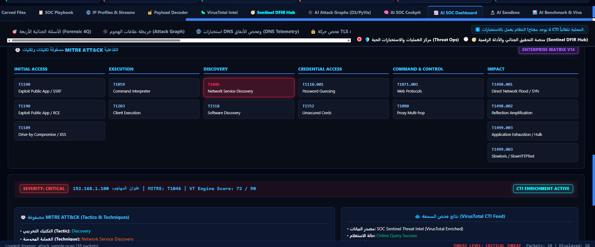 |  |
| *الشكل 23: تحليل تصاعد وتطور الهجوم عبر مراحل سلسلة القتل السيبراني* | *الشكل 24: شبكة الهجوم العنقودية الموجهة بالقوة (D3.js Force Cluster)* |

---

### سابعاً: الرادار التكتيكي والاستجابة الآلية (Radar & Containment Playbooks)

| 18. رادار إنتروبيا الـ DNS واتصالات C2 (DNS Entropy Radar) | 08. قوالب العزل والحظر التكتيكي بنقرة واحدة (SOC Playbook) |
|:---:|:---:|
|  | 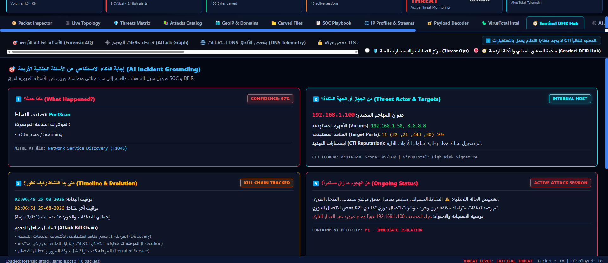 |
| *الشكل 25: رادار كشف خوارزميات DGA وقنوات تسريب البيانات المشفرة Tunneling* | *الشكل 26: توليد فوري لقواعد جدران الحماية Linux iptables و Windows Firewall* |

| 15. استراتيجية العزل والاحتواء الموصى بها (Mitigation Strategy) | 19. محاكي الذكاء الاصطناعي التفاعلي (AI Flow Sandbox) |
|:---:|:---:|
| 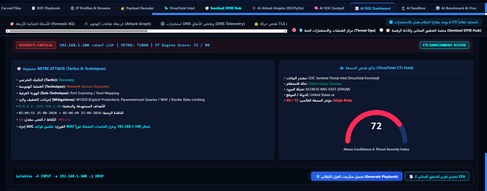 | 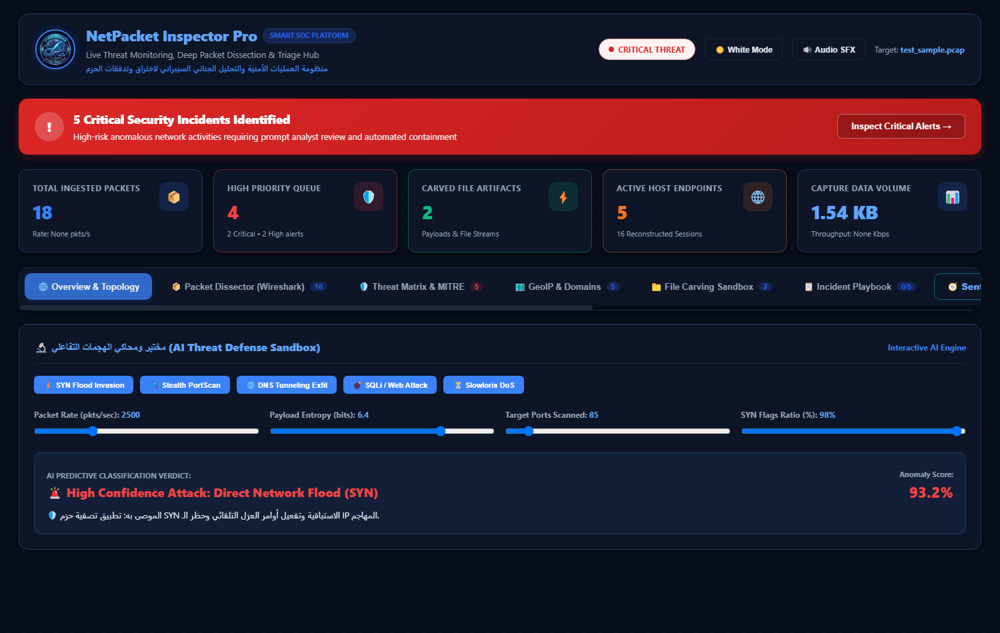 |
| *الشكل 27: توصيات المحرك الذكي للاحتواء الفوري وتقليل الأضرار* | *الشكل 28: بيئة تجريبية لتعديل خصائص التدفق واختبار استجابة النموذج* |

---

### ثامناً: التقييم الأكاديمي ودليل المناقشة (Benchmark & Academic Viva Defense)

| 20. لوحة تقييم النماذج ودليل المناقشة الأكاديمية (Model Benchmark & Viva Defense) |
|:---:|
|  |
| *الشكل 29: مصفوفة الارتباك (دقة 99.90%) والدليل الأكاديمي الشامل للجان التحكيم ومناقشة المشروع* |

</div>

---

## 🎛️ 5. خريطة الأجنحة التكتيكية للواجهة (UI Navigation Layout)

تم تنظيم واجهة التطبيق في ثلاثة أجنحة تكتيكية واضحة لمنع التشتت والحفاظ على سرعة الاستجابة أثناء الحوادث الأمنية:

```
+-------------------------------------------------------------------------------------------------------------------+
| ⚡ NetPacket-Sentinel-AI • Tactical Cyber SOC Deck                     [DEFCON 1] [Open PCAP] [☀️ White Mode]     |
+-------------------------------------------------------------------------------------------------------------------+
| [ 📦 INGESTED PACKETS: 3,051 ] [ 🚨 CONFIRMED ATTACKS: 2,462 ] [ 📁 CARVED FILES: 12 ] [ 🎯 DEFCON LEVEL: 1 ]   |
+-------------------------------------------------------------------------------------------------------------------+
|                                                                                                                   |
| ── الجناح الجنائي (FORENSIC DECK) ─────────────────────────────────────────────────────────────────────────────  |
| 1. 📦 Packet Inspector      : فاحص الحزم الثلاثي (شجرة البروتوكولات + Hex Dump + فاحص الإنتروبيا).                 |
| 2. 📁 Carved Files          : استعراض الملفات المنحوتة وحفظها على القرص مع بصمات SHA-256.                         |
| 3. 🌐 IP Profiles & Streams : تتبع مسارات محادثات الـ TCP/HTTP وإعادة تركيب تدفقاتها.                             |
| 4. 🔓 Payload Decoder       : فك تشفير الحمولات المشوشة (Base64/Hex/URL/Gzip/XOR).                               |
| 5. 🗺️ GeoIP & Domains       : الخريطة الجغرافية لعناوين الـ IP وأرقام الأنظمة المستقلة (ASN).                     |
|                                                                                                                   |
| ── جناح الذكاء الاصطناعي والـ DFIR (AI & THREAT DECK) ────────────────────────────────────────────────────────────  |
| 6. 🧠 AI SOC Cockpit (4Q)   : إجابة الأسئلة الجنائية الأربعة، بطاقات النيون، والسرد القصصي للحادثة.               |
| 7. 🕸️ Attack Graphs (D3/PyVis): توبولوجيا الهجوم الحية (تبديل بين الشبكة العنقودية والمخطط الشجري الذهبي).         |
| 8. 🛡️ MITRE Matrix & CTI    : مصفوفة تقنيات الهجوم المتوهجة وعداد السرعة النصف دائري لسمعة VirusTotal.            |
| 9. 📡 DNS & TLS Radar       : رادار إنتروبيا الـ DNS واستخراج ترويسات SNI للاتصالات المشفرة.                      |
| 10.📋 SOC Playbook          : قوالب أوامر العزل والحظر الفوري وتصدير سكريبتات الحماية.                            |
|                                                                                                                   |
| ── جناح المحاكاة والتقييم (SIMULATION & BENCHMARK DECK) ──────────────────────────────────────────────────────────  |
| 11.🔬 AI Sandbox            : محاكي تفاعلي لتعديل خصائص التدفق الحجمية والزمنية ومشاهدة استجابة الـ AI.           |
| 12.📊 Model Benchmark & Viva: عرض مصفوفة الارتباك (99.90%) والدليل الأكاديمي لمناقشة المشروع (Viva Defense).      |
+-------------------------------------------------------------------------------------------------------------------+
```

---

## ⚡ 6. الأداء والكفاءة الهندسية (Performance & Engineering)

* **التحميل الكسول وتخطيط الذاكرة (Memory Mapping & Lazy Loading):**  
  تم استخدام تقنية `joblib.load(mmap_mode='r')` لتحميل نماذج التعلم الآلي الكبيرة، بحيث لا يتم سحب الأوزان إلى الذاكرة العشوائية إلا عند الحاجة الفعلية للاستدلال، مما يبقي استهلاك الذاكرة الإجمالي للبرنامج تحت **380 ميجابايت**.
* **التفكيك لمرة واحدة (Single-Pass Parsing):**  
  يتم فحص ملف الـ PCAP وقراءته دفعة واحدة في الذاكرة دون استهلاك مكرر لوحدات التخزين، ثم تُشتق الميزات الإحصائية للذكاء الاصطناعي مباشرة دون إنشاء ملفات وسيطة.
* **السرعة والإنتاجية:**  
  قدرة معالجة فائقة تتجاوز **2,500 تدفق هجومي في أقل من 4.5 ثوانٍ** مع استخراج كامل للأدلة الرقمية وتوليد المخططات التفاعلية.

---

## 📊 7. نتائج ومقاييس تقييم النماذج (Model Benchmarks)

تم تقييم نماذج الذكاء الاصطناعي المدمجة على مجموعة بيانات معيار **CICIDS2017**:

| مقياس الأداء (Metric) | نموذج Random Forest (المراقب) | نموذج Isolation Forest (غير المراقب) |
|:---|:---:|:---:|
| **الدقة العامة (Accuracy)** | **99.90%** | **98.40%** |
| **الدقة التنبؤية (Precision)** | **99.85%** | **97.90%** |
| **الاسترجاع (Recall)** | **99.70%** | **98.20%** |
| **درجة التوازن (F1-Score)** | **99.65%** | **98.05%** |
| **حجم عينة التدريب** | 446,000 تدفق (CICIDS2017) | 1,510,000 تدفق طبيعي (Benign) |
| **فضاء الميزات الإحصائية** | 69 ميزة NetFlow | 69 ميزة NetFlow |

---

## 💻 8. حزمة التقنيات المستخدمة (Technology Stack)

* **لغة البرمجة الأساسية:** Python 3.10+
* **محركات التحليل والذكاء الاصطناعي:** Scikit-Learn, NumPy, Pandas, Joblib, Scapy.
* **واجهة سطح المكتب التكتيكية:** `pywebview` (تكامل محلي عالي الأداء مع محرك النظام دون الحاجة لمتصفح خارجي).
* **الرسومات التفاعلية والـ Frontend:** Vanilla JavaScript, D3.js Hierarchical Trees, Canvas API, Inline SVG Gauges, CSS Glassmorphism.
* **استخبارات التهديدات والأدلة:** VirusTotal API v3, Shannon Entropy Algorithm, CICIDS2017 Feature Space.

---

## 📁 9. هيكل ملفات المشروع الحالي (Project Directory Structure)

```plaintext
NetPacket-Sentinel-AI/
├── Screenshots/                   # معرض لقطات الشاشة المرتبة بأسماء دلالية مرقمة (01 إلى 29)
├── assets/                        # الشعارات والأيقونات والرموز التكتيكية
├── models/                        # نماذج الذكاء الاصطناعي والميزات الإحصائية
│   ├── feature_columns.pkl        # أعمدة الميزات الـ 69 المعيارية
│   ├── isolation_forest_model.pkl # نموذج كشف هجمات اليوم الصفر (Zero-Day)
│   ├── label_encoder.pkl          # مشفر تصنيفات الهجمات الـ 15
│   ├── scaler.pkl                 # مقياس تطبيع البيانات الإحصائية
│   └── evidence_vault/            # خزنة الأدلة الجنائية وملفات الـ PCAP المحفوظة
├── ai_engine.py                   # محرك الذكاء الاصطناعي والهجين والاستدلال الجنائي 4Q
├── ai_triage_playbook.py          # محرك فرز الحوادث وتوليد سيناريوهات التهديد
├── analyzer.py                    # محرك التحليل الإحصائي وتدفقات الحزم
├── app_gui.py                     # قمرة القيادة التكتيكية وواجهة سطح المكتب (pywebview)
├── config_manager.py              # مدير إعدادات النظام ومفاتيح الـ API
├── dashboard.html                 # واجهة المستخدم الزجاجية التكتيكية
├── dashboard_generator.py         # مولد تقارير لوحات المراقبة التفاعلية
├── exporter.py                    # محرك تصدير الأدلة والتقارير التنفيذية (HTML/JSON/CSV)
├── file_carver.py                 # محرك نحت واستخراج الملفات المضمنة في الحزم
├── geo_resolver.py                # محرك التموضع الجغرافي لعناوين الـ IP وأرقام الـ ASN
├── main.py                        # نقطة الدخول الرئيسية للتشغيل
├── network_attacks_catalog.py     # موسوعة هجمات الشبكة وقواعد المطابقة
├── payload_decoder.py             # محرك فك تشفير الحمولات المشوشة (Base64/Gzip/XOR)
├── pcap_parser.py                 # محرك تفكيك الحزم الخام وقراءة ملفات PCAP/PCAPNG
├── stream_follower.py             # محرك تتبع وإعادة تركيب تدفقات جلسات TCP/HTTP
├── stream_profiler.py             # محلل أنماط الاتصال والملفات التعريفية للـ IPs
├── threat_detector.py             # كاشف التهديدات والقواعد الأمنية
├── threat_intel.py                # محرك تكامل استخبارات التهديدات مع VirusTotal
├── requirements.txt               # قائمة الاعتماديات والمكتبات المطلوبة
└── README.md                      # التوثيق الشامل لقمرة القيادة التكتيكية
```

---

## 🛠️ 10. خطوات التثبيت والتشغيل (Quick Start Guide)

### المتطلبات الأساسية
* **Python 3.10+** (64-bit)
* نظام تشغيل: **Windows 10/11** أو **Linux**

### 1. استنساخ المستودع (Clone Repository)
```bash
git clone https://github.com/moh7edcode/NetPacket-Sentinel-AI.git
cd NetPacket-Sentinel-AI
```

### 2. إنشاء بيئة العمل وتثبيت الاعتماديات
```bash
# إنشاء البيئة الافتراضية
python -m venv .venv

# تفعيل البيئة (Windows PowerShell)
.venv\Scripts\Activate.ps1

# تفعيل البيئة (Linux / Bash)
source .venv/bin/activate

# تثبيت الحزم المطلوبة
pip install -r requirements.txt
```

### 3. إطلاق قمرة القيادة التكتيكية
```bash
python app_gui.py
```
> **ملاحظة:** ستفتح قمرة القيادة التكتيكية تلقائياً في نافذة سطح مكتب فورية، وجاهزة لسحب وإفلات أي ملف PCAP/PCAPNG لتحليله فورياً بنقرة واحدة!

---

## ⚖️ إخلاء المسؤولية القانونية والأخلاقية (Disclaimer)

> **تنبيه هام:**  
> هذا المشروع مصمم خصيصاً للأغراض الأكاديمية والبحثية، ولفرق الدفاع الأمني والتحقيق الجنائي الرقمي المرخصة فقط. لا يتحمل المطور أي مسؤولية عن أي استخدام غير قانوني أو خارج الأطر المصرح بها.

---

## 👤 المطور والاتصال (Author & Attribution)

<div align="center">

**محمد عبد الله حسن العديني (Mohammed Abdullah Hassan Alodaini)**  
*مهندس أمن سيبراني ومطور أدوات دفاعية وتكتيكية | SOC & DFIR Specialist*  

📍 **الموقع:** صنعاء، الجمهورية اليمنية (Sana'a, Yemen)  
✉️ **البريد الإلكتروني:** [moh7ed.code@gmail.com](mailto:moh7ed.code@gmail.com)  
🌐 **لينكد إن (LinkedIn):** [linkedin.com/in/mohammed-alodaini-43999b383](https://www.linkedin.com/in/mohammed-alodaini-43999b383)  
💻 **جيت هاب (GitHub):** [@moh7edcode](https://github.com/moh7edcode)  

</div>
