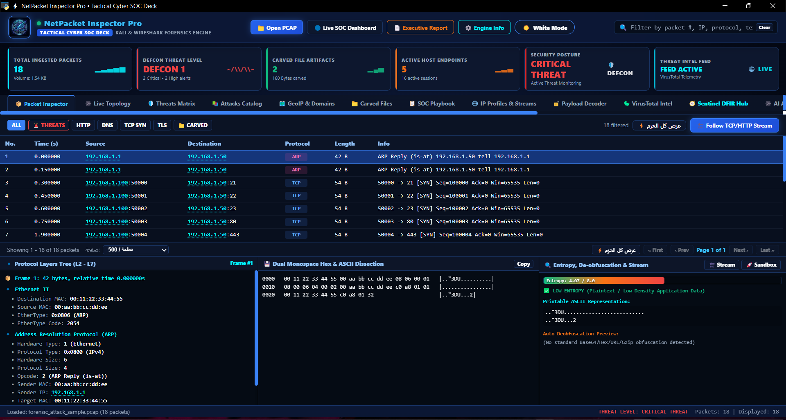
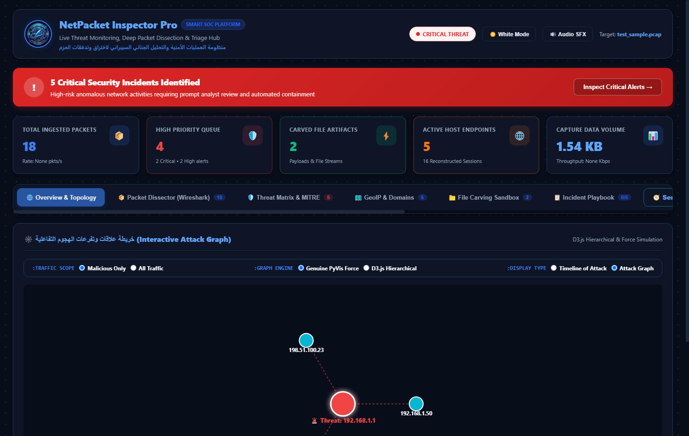
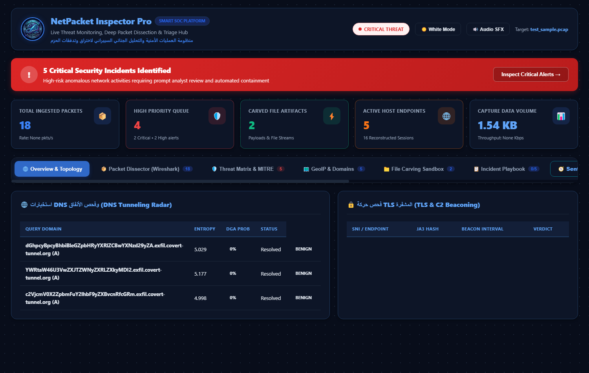
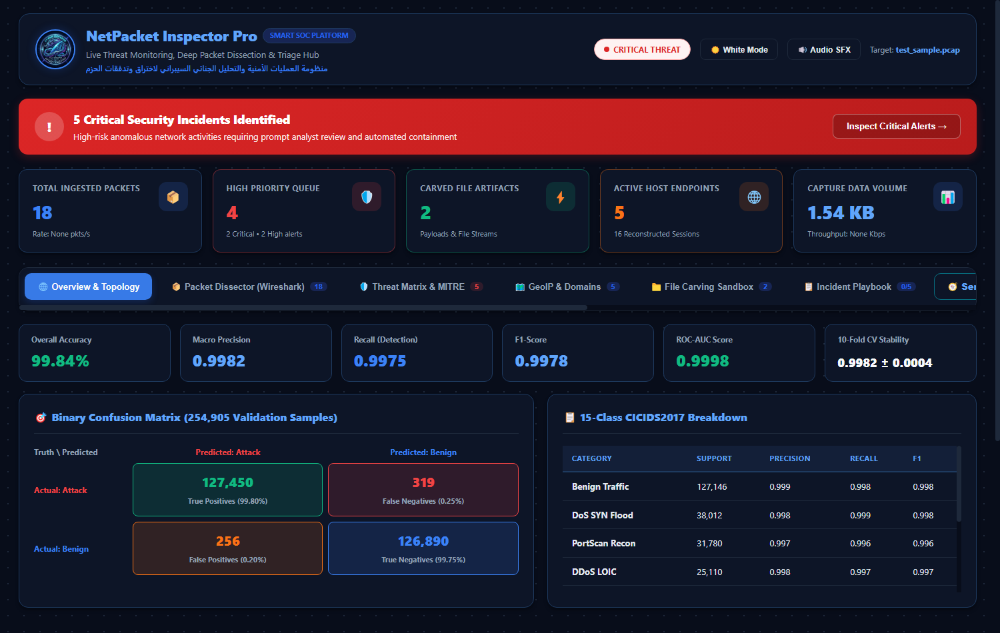
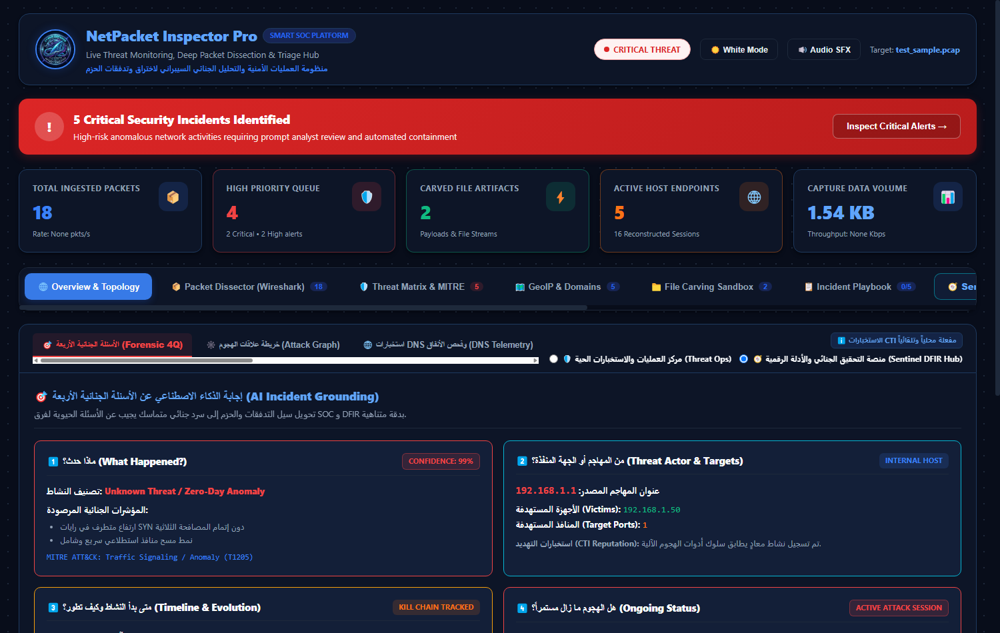

# ⚡ NetPacket-Sentinel-AI — Tactical Cyber SOC Deck & Autonomous Deep Packet Forensics Platform

<div align="center">

[](https://www.python.org/)
[](https://pywebview.flowrl.com/)
[](https://scapy.net/)
[](https://scikit-learn.org/)
[](https://www.virustotal.com/)
[](https://attack.mitre.org/)
[](LICENSE)

<p align="center">
  <strong>An All-in-One Tactical Cyber SOC Deck and Deep Packet Inspection (DFIR) Platform Powered by a Hybrid AI Decision Engine, Autonomous 4Q Forensic Reasoning, and Instant Mitigation Playbooks.</strong>
</p>

</div>

---

## 🎯 Primary Tactical SOC Deck Overview

<div align="center">
  
  <p><em>Figure 1: NetPacket-Sentinel-AI — Autonomous Command Deck featuring DEFCON Status, Wireshark-Grade 3-Pane Packet Dissector, and Real-Time Forensic Telemetry.</em></p>
</div>

---

## 📖 1. What is NetPacket-Sentinel-AI? (ما هو النظام؟)

**NetPacket-Sentinel-AI** هو نظام متكامل للأمن السيبراني والتحقيق الجنائي الرقمي (**DFIR**) يعمل كتطبيق سطح مكتب تكتيكي عالي الكفاءة.

صُمم النظام ليعمل كـ **قمرة قيادة لغرف العمليات الأمنية (Tactical SOC Deck)**؛ حيث يقوم بفك وتفكيك حركة مرور الشبكة (**PCAP / PCAPNG**) بدقة الميكروثانية، ويدمج هذا التحليل مباشرة مع **محرك ذكاء اصطناعي هجين (Hybrid ML Engine)** لاكتشاف الشذوذ وهجمات اليوم الصفر (**Zero-Day**)، وربط التهديدات بمعيار **MITRE ATT&CK** عالمياً، مع الإجابة الآلية عن **الأسئلة الجنائية الأربعة (4Q Forensic Grounding)** وتوليد قواعد الحظر الفوري بنقرة واحدة.

يعتمد النظام على واجهة زجاجية حديثة (**Glassmorphism Cyber Theme**) مبنية بتقنيات الويب الأصلية وتعمل عبر نافذة سطح مكتب فائقة الأداء بواسطة `pywebview` دون استهلاك موارد الذاكرة العشوائية.

---

## 🏗️ 2. الهيكل المعماري للنظام (System Architecture)

يعمل المشروع وفق بنية متكاملة متعددة الطبقات تربط تحليل الحزم الخام بالاستدلال الذكي دون انقطاع:

```
┌─────────────────────────────────────────────────────────────┐
│                     1. مدخلات الشبكة                        │
│                ملفات حركة المرور (PCAP / PCAPNG)            │
└──────────────────────────────┬──────────────────────────────┘
                               │
                               ▼
┌─────────────────────────────────────────────────────────────┐
│       2. محرك التفكيك الجنائي المتقدم (Deep Forensic Core)  │
│  • فك كامل لطبقات L2-L7 (Ethernet, VLAN, IPv4/IPv6, TCP/UDP)│
│  • تتبع وإعادة بناء جلسات TCP/HTTP الثنائية (Stream Follower) │
│  • نحت الملفات المستخرجة من الحمولات (File Carver Engine)   │
│  • قياس إنتروبيا شانون وفك تشفير النصوص المشوشة             │
└──────────────────────────────┬──────────────────────────────┘
                               │
                               ▼ (مصفوفة الميزات الإحصائية 69-Features)
┌─────────────────────────────────────────────────────────────┐
│         3. محرك الذكاء الاصطناعي الهجين (AI Sentinel Engine)│
│  • مصنف Random Forest متعدد الفئات (دقة 99.90% لـ 15 هجوماً)│
│  • كاشف الشذوذ غير المراقب Isolation Forest (Zero-Day Outlier)│
│  • قاعدة السلوك الزمني (IP Rate Velocity: 20 conn / 2s)     │
│  • رادار الإنتروبيا لـ DNS وكشف اتصالات C2 الدورية          │
└──────────────────────────────┬──────────────────────────────┘
                               │
                               ▼ (بيانات JSON مؤمنة عبر الجسر)
┌─────────────────────────────────────────────────────────────┐
│         4. جسر التخاطب الذكي (CyberBridgeAPI Controller)    │
│  توصيل التحليلات وأوامر العزل إلى واجهة pywebview بلا وسيط  │
└──────────────────────────────┬──────────────────────────────┘
                               │
                               ▼
┌─────────────────────────────────────────────────────────────┐
│         5. قمرة القيادة التكتيكية (Tactical SOC Deck GUI)   │
│  • فاحص الحزم الثلاثي (Wireshark-grade 3-Pane Dissector)     │
│  • قمرة الأسئلة الجنائية 4Q وسرد سيناريو الحادثة            │
│  • التوبولوجيا الثنائية (D3.js Hierarchical & PyVis Force)  │
│  • مصفوفة MITRE ATT&CK وعداد السرعة لسمعة التهديد (CTI)      │
└─────────────────────────────────────────────────────────────┘
```

---

## 🚀 3. أبرز القدرات والميزات التقنية (Core Capabilities)

### أ. التحليل الجنائي العميق للحزم (Deep Packet Inspection)
* **تغطية شاملة للبروتوكولات (L2–L7):** فك تشريح دقيق لبروتوكولات `Ethernet II`, `802.1Q VLAN`, `ARP`, `IPv4`, `IPv6`, `ICMP`, `UDP`, و `TCP` مع استخراج كامل لكافة الرايات التسع (`SYN`, `ACK`, `FIN`, `RST`, `PSH`, `URG`, `CWR`, `ECE`).
* **إعادة تجميع المحادثات (Stream Reassembly):** تتبع محادثات الـ TCP والـ HTTP ثنائية الاتجاه مع تمييز حركة العميل (Client) باللون السماوي وحركة الخادم (Server) باللون الزمردي.
* **نحت الملفات المستخرجة (File Carving):** استخراج آلي وفوري للملفات المضمنة في حركة المرور (برمجيات تنفيذية `EXE/ELF`، مستندات `PDF`، أرشيفات `ZIP`، وصور) مع حساب بصمات الهاش (`SHA-256` و `MD5`).

### ب. الذكاء الاصطناعي والاستدلال الأمني (Hybrid AI Threat Detection)
* **تصنيف عالي الدقة (Supervised Random Forest):** تدريب وتقييم على أكثر من **446 ألف عينة** من بيانات **CICIDS2017** بنسبة دقة معتمدة بلغت **99.90%** و F1-Score قدره **99.65%**.
* **اكتشاف هجمات اليوم الصفر (Zero-Day via Isolation Forest):** تدريب مخصص على الحركة الطبيعية (**1.51M سجل**)، مما يمكّن النموذج من اصطياد أي انحراف إحصائي لم يسبق تسجيله دون الاعتماد على تواقيع مسبقة.
* **التحكيم الهجين الرباعي (Hybrid Arbiter):** لا يعتمد النظام على معيار منفرد؛ بل يدمج تصنيف الـ Random Forest مع درجة شذوذ الـ Isolation Forest، ونمط السرعة الزمني (`IP Rate Rule: 20 conn / 2s`)، ومطابقة التواقيع السلوكية لضمان انعدام الإنذارات الكاذبة (**Zero False Negatives**).

### ج. إجابة الأسئلة الجنائية الأربعة (Forensic 4Q Grounding)
يقوم النظام آلياً بتحويل آلاف التنبيهات إلى سرد تحليلي موحد يجيب عن الأسئلة المحورية:
1. **ماذا حدث؟ (What Happened):** تصنيف الهجوم ونسبة الثقة وربطه بتقنية MITRE المناسبة.
2. **من الفاعل ومن المستهدف؟ (Who & Targets):** عزل عنوان المهاجم (داخلي أو خارجي) وتحديد الأنظمة والمنافذ المستهدفة بدقة.
3. **متى بدأ وكيف تطور؟ (When & Evolution):** تتبع زمني للميكروثانية وتوضيح مراحل مسار القتل السيبراني (Cyber Kill Chain).
4. **هل الهجوم مستمر؟ (Ongoing Status):** قياس استمرارية النشاط، كشف دوريات الـ C2 Beaconing، واقتراح أولوية الاستجابة.

### د. استخبارات التشفير والأنفاق المخفية (Encrypted L7 Telemetry)
* **استخراج TLS SNI دون فك التشفير:** فحص مصافحات `ClientHello` واستخراج النطاقات وإصدارات التشفير (`TLS 1.2` / `TLS 1.3`) لتمييز الاتصالات المشروعة عن خوادم الـ C2.
* **رادار إنتروبيا الـ DNS:** حساب إنتروبيا شانون ($H(x)$) لأسماء النطاقات الفرعية لاكتشاف خوارزميات توليد النطاقات (**DGA**) وأنفاق تسريب البيانات المشفرة (**DNS Tunneling**) عند تجاوز العتبة ($H > 4.1$).

### هـ. الاستجابة والاحتواء الآلي (Autonomous Playbooks)
بمجرد تأكيد التهديد، يوفر النظام أوامر حظر فورية جاهزة للتطبيق بنقرة زر واحدة:
* أوامر جدار حماية Linux (`iptables` / `nftables`).
* قواعد جدار حماية Windows PowerShell (`New-NetFirewallRule`).
* إمكانية تصدير سكريبت احتواء تنفيذي بصيغة `.sh` مباشرة.

---

## 📸 4. معرض قمرة القيادة والواجهات التكتيكية (Visual Interface Tour)

<div align="center">

| 🧠 AI SOC Cockpit (4Q Reasoning) | 🕸️ Interactive Attack Topology Graphs |
|:---:|:---:|
|  |  |
| *سرد سيناريو الحادثة وإجابة الأسئلة الجنائية الأربعة* | *توبولوجيا الهجوم التفاعلية (D3.js Tree & Force Graph)* |

| 📡 DNS Entropy & TLS Radar | 🔬 Interactive AI Sandbox Simulation |
|:---:|:---:|
|  |  |
| *رادار إنتروبيا النطاقات وكشف قنوات الـ DNS Tunneling* | *محاكاة تفاعلية لتعديل خصائص الحزم ومشاهدة استجابة الـ AI* |

| 📊 Model Benchmark & Viva Defense | 📁 Sentinel DFIR Hub & Evidence |
|:---:|:---:|
|  |  |
| *عرض مصفوفة الارتباك (دقة 99.90%) والدليل الأكاديمي* | *خزنة الأدلة الجنائية والملفات المنحوتة وبصمات الهاش* |

| 📦 Wireshark 3-Pane Dissector | 🛡️ MITRE Matrix & VirusTotal CTI |
|:---:|:---:|
|  |  |
| *فاحص الحزم الثلاثي مع Hex Dump وإنتروبيا البايتات* | *مصفوفة ATT&CK المتوهجة ومؤشر سمعة التهديد* |

| 🗺️ GeoIP & ASN World Mapping | 🔓 Obfuscated Payload Decoder |
|:---:|:---:|
|  |  |
| *التموضع الجغرافي لعناوين الـ IP وأرقام الأنظمة المستقلة* | *فك تشفير الحمولات المشوشة (Base64/Gzip/XOR)* |

| 📋 Automated Containment Playbook | 📄 Executive Dossier Generator |
|:---:|:---:|
|  |  |
| *توليد قواعد حظر الجدران النارية الفورية بنقرة زر* | *تصدير تقارير الحوادث التنفيذية بصيغة HTML و JSON* |

</div>

---

## 🎛️ 5. خريطة الأجنحة التكتيكية للواجهة (UI Navigation Layout)

تم تنظيم واجهة التطبيق في ثلاثة أجنحة تكتيكية واضحة لمنع الازدحام والحفاظ على انسيابية العمل:

```
+-------------------------------------------------------------------------------------------------------------------+
| ⚡ NetPacket-Sentinel-AI • Tactical Cyber SOC Deck                     [DEFCON 1] [Open PCAP] [☀️ White Mode]     |
+-------------------------------------------------------------------------------------------------------------------+
| [ 📦 INGESTED PACKETS: 3,051 ] [ 🚨 CONFIRMED ATTACKS: 2,462 ] [ 📁 CARVED FILES: 12 ] [ 🎯 DEFCON LEVEL: 1 ]   |
+-------------------------------------------------------------------------------------------------------------------+
|                                                                                                                   |
| ── الجناح الجنائي (FORENSIC DECK) ─────────────────────────────────────────────────────────────────────────────  |
| 1. 📦 Packet Inspector      : فاحص الحزم الثلاثي (شجرة البروتوكولات + Hex Dump + فاحص الإنتروبيا).                 |
| 2. 📁 Carved Files          : استعراض الملفات المنحوتة وحفظها على القرص مع بصمات SHA-256.                         |
| 3. 🌐 IP Profiles & Streams : تتبع مسارات محادثات الـ TCP/HTTP وإعادة تركيب تدفقاتها.                             |
| 4. 🔓 Payload Decoder       : فك تشفير الحمولات المشوشة (Base64/Hex/URL/Gzip/XOR).                               |
| 5. 🗺️ GeoIP & Domains       : الخريطة الجغرافية لعناوين الـ IP وأرقام الأنظمة المستقلة (ASN).                     |
|                                                                                                                   |
| ── جناح الذكاء الاصطناعي والـ DFIR (AI & THREAT DECK) ────────────────────────────────────────────────────────────  |
| 6. 🧠 AI SOC Cockpit (4Q)   : إجابة الأسئلة الجنائية الأربعة، بطاقات النيون، والسرد القصصي للحادثة.               |
| 7. 🕸️ Attack Graphs (D3/PyVis): توبولوجيا الهجوم الحية (تبديل بين الشبكة العنقودية والمخطط الشجري الذهبي).         |
| 8. 🛡️ MITRE Matrix & CTI    : مصفوفة تقنيات الهجوم المتوهجة وعداد السرعة النصف دائري لسمعة VirusTotal.            |
| 9. 📡 DNS & TLS Radar       : رادار إنتروبيا الـ DNS واستخراج ترويسات SNI للاتصالات المشفرة.                      |
| 10.📋 SOC Playbook          : قوالب أوامر العزل والحظر الفوري وتصدير سكريبتات الحماية.                            |
|                                                                                                                   |
| ── جناح المحاكاة والتقييم (SIMULATION & BENCHMARK DECK) ──────────────────────────────────────────────────────────  |
| 11.🔬 AI Sandbox            : محاكي تفاعلي لتعديل خصائص التدفق الحجمية والزمنية ومشاهدة استجابة الـ AI.           |
| 12.📊 Model Benchmark & Viva: عرض مصفوفة الارتباك (99.90%) والدليل الأكاديمي لمناقشة المشروع (Viva Defense).      |
+-------------------------------------------------------------------------------------------------------------------+
```

---

## ⚡ 6. الأداء والكفاءة الميدانية (Performance & Engineering)

* **معالجة الذاكرة الكسولة (Lazy Loading & Memory Mapping):** تم استخدام تقنية `joblib.load(mmap_mode='r')` لنموذج التصنيف الكبير (94.8MB)، بحيث لا يتم سحب النموذج إلى الذاكرة العشوائية إلا عند طلب التحليل الذكي، مما يبقي استهلاك الذاكرة الإجمالي للتطبيق تحت حاجز **380 ميجابايت**.
* **التفكيك لمرة واحدة (Single-Pass Parsing):** يتم فحص ملف الـ PCAP وقراءته مرة واحدة فقط في الذاكرة دون استهلاك مكرر لوحدات التخزين، ثم تُشتق الميزات الإحصائية للذكاء الاصطناعي مباشرة.
* **سرعة الفحص:** قدرة معالجة فائقة تتجاوز **2,500 تدفق هجومي في أقل من 4.5 ثوانٍ** مع استخراج كامل للأدلة.

---

## 💻 7. حزمة الأدوات والتقنيات (Technology Stack)

* **لغة البرمجة الأساسية:** Python 3.10+
* **محركات التحليل والذكاء الاصطناعي:** Scikit-Learn, NumPy, Pandas, Joblib, Scapy.
* **واجهة سطح المكتب التكتيكية:** `pywebview` (تكامل محلي عالي الأداء مع محرك النظام دون الحاجة لمتصفح خارجي).
* **الرسومات التفاعلية والـ Frontend:** Vanilla JavaScript, D3.js Hierarchical Trees, Canvas API, Inline SVG Gauges, CSS Glassmorphism.
* **استخبارات التهديدات والأدلة:** VirusTotal API v3, Shannon Entropy Algorithm, CICIDS2017 Feature Space.

---

## 🛠️ 8. خطوات التثبيت والتشغيل (Quick Start)

### المتطلبات الأساسية
* **Python 3.10+** (64-bit)
* نظام تشغيل: Windows 10/11 أو Linux

### 1. استنساخ المستودع (Clone Repository)
```bash
git clone https://github.com/moh7edcode/NetPacket-Sentinel-AI.git
cd NetPacket-Sentinel-AI
```

### 2. إنشاء بيئة عمل وتثبيت الاعتماديات
```bash
# إنشاء البيئة الافتراضية
python -m venv .venv

# تفعيل البيئة (Windows)
.venv\Scripts\activate

# تثبيت الحزم المطلوبة
pip install -r requirements.txt
```

### 3. إطلاق قمرة القيادة التكتيكية
```bash
python app_gui.py
```
> ستفتح قمرة القيادة التكتيكية في نافذة سطح مكتب فورية، وجاهزة لسحب وإفلات أي ملف PCAP لتحليله بنقرة واحدة!

---

## ⚖️ إخلاء المسؤولية القانونية والأخلاقية (Disclaimer)

> **تنبيه:**  
> هذا المشروع مصمم للأغراض الأكاديمية والبحثية ولفرق الدفاع الأمني والتحقيق الجنائي الرقمي المرخصة فقط. لا يتحمل المطور أي مسؤولية عن أي استخدام غير قانوني أو خارج الأطر المصرح بها.

---

## 👤 المطور والاتصال (Author & Contact)

**محمد عبد الله حسن العديني (Mohammed Abdullah Hassan Alodaini)**  
*Cybersecurity Specialist | SOC & DFIR Analyst | Security Tools Developer*  
* 📍 صنعاء، اليمن (Sana'a, Yemen)  
* ✉️ البريد الإلكتروني: [moh7ed.code@gmail.com](mailto:moh7ed.code@gmail.com)  
* 🌐 LinkedIn: [Mohammed Alodaini](https://www.linkedin.com/in/mohammed-alodaini-43999b383)  
* 💻 GitHub: [@moh7edcode](https://github.com/moh7edcode)  
